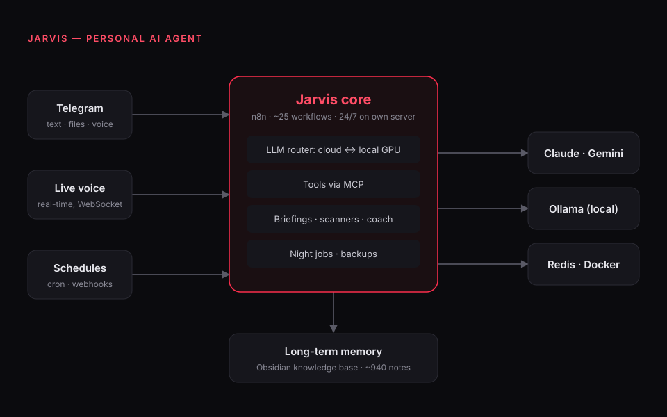
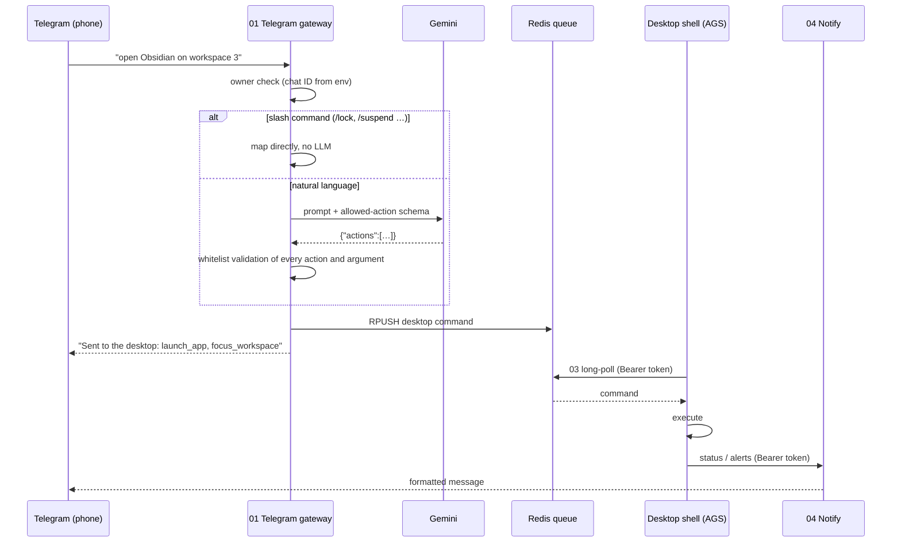

# Jarvis: a personal AI agent

Jarvis is my personal AI agent. It runs 24/7 on my own server: I talk to it in Telegram or by voice, it remembers things in a knowledge base, and ~25 n8n workflows do the actual work around the clock.

> **This is a showcase repo.** The production code and the knowledge base are private (they contain my personal data). Here you'll find the architecture, how the pieces talk to each other, and a set of real workflows, cleaned of credentials, that you can import into your own n8n.

## What it does

| Area | How |
|---|---|
| **Chat** | Telegram bot: text, files, voice messages. Only the owner's chat ID gets an answer; everything else is dropped silently. |
| **Live voice** | Real-time voice conversation over WebSocket (Gemini Live). |
| **Memory** | An Obsidian vault (~940 notes) is the long-term memory the agent draws context from. |
| **Model routing** | Cloud LLMs (Claude, Gemini) for hard tasks, local models via Ollama on my own GPU for cheap and private ones. |
| **Tools** | Tools are exposed to the agent through MCP servers. |
| **Automations** | ~25 n8n workflows: morning briefing, market scanner, habit coach, night jobs, backups. |
| **Desktop** | My Linux desktop shell ([hyprland-ags-shell](https://github.com/pavlohavras73/hyprland-ags-shell)) has an AI command bar wired to Jarvis, and I can control the desktop from my phone. |
| **Ops** | Docker, Redis, Caddy with auto-TLS, firewall, nightly backups, all on one VPS. |

## Example: controlling my desktop from the phone

The workflows in [`workflows/`](workflows/) are the real ones behind this feature. Together they form one loop:

| File | What it does |
|---|---|
| [`01-telegram-gateway.json`](workflows/01-telegram-gateway.json) | Telegram trigger → owner check → slash commands or LLM intent parsing → whitelist → Redis queue → confirmation |
| [`02-intent-parser.json`](workflows/02-intent-parser.json) | The same intent parsing as an HTTP endpoint, used by the command bar on the desktop |
| [`03-desktop-command-poll.json`](workflows/03-desktop-command-poll.json) | The desktop polls for queued commands (Redis BLPOP) |
| [`04-notify-telegram.json`](workflows/04-notify-telegram.json) | The desktop sends alerts back to my Telegram (e.g. low-memory warnings) |

### Design decisions

- **The LLM never executes anything directly.** It only proposes actions as JSON. Every action and every argument is checked against a whitelist (app names, workspace range 1–10, volume 0–100…) before it reaches the queue. A hallucinated or injected action is dropped.
- **No secrets in workflows.** Tokens and IDs come from environment variables (`DESKTOP_AGS_TOKEN`, `GEMINI_API_KEY`, `OWNER_CHAT_ID`); credentials are referenced by ID only.
- **Pull, not push.** The desktop is behind NAT, so it polls the queue instead of exposing a port.
- **Cheap path first.** Slash commands skip the LLM entirely.

## Try the workflows

1. In n8n: *Workflows → Import from file*, pick a JSON from `workflows/`.
2. Create a Telegram and a Redis credential and select them in the nodes marked `REPLACE_WITH_YOUR_CREDENTIAL_ID`.
3. Set the environment variables above for your n8n instance (`DESKTOP_AGS_TOKEN` must be at least 32 characters).

## Stack

`n8n` `Claude` `Gemini` `Ollama` `MCP` `Redis` `Docker` `Caddy` `Telegram Bot API` `Obsidian`

---

Built by [Pavlo Havras](https://github.com/pavlohavras73).
